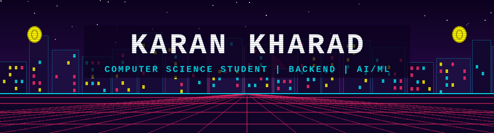
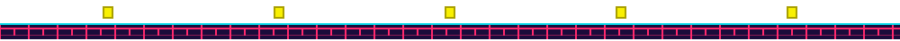
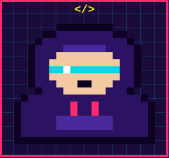
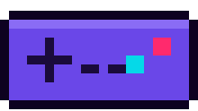
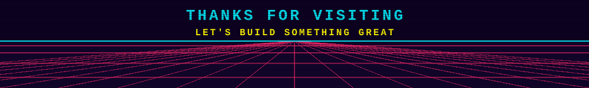

  

  
  
  
  

<h2 align="center"><i>🛠️ Technologies</i></h2>

  
  
  
  
  
  
  
  
  
  
  
  
  
  
  
  
  
  
  

<h2 align="center"><i>📊 Statistics</i></h2>

  

  
  

<h2 align="center"><i>👤 About Me</i></h2>

Hello! My name is <b>Karan Kharad</b>, and I am a Computer Science student pursuing a <b>B.Voc</b> degree. I am passionate about software development, artificial intelligence, open source, and emerging technologies. Currently, I am improving my skills in <b>Python, Django, Flask, PHP, JavaScript, and SQL</b>, with a focus on backend engineering, AI systems, and open source contribution, and I am working toward building robust, impactful applications.

 

<h2 align="center"><i>🎯 Hobbies &amp; Goals</i></h2>

Computer Science student with a strong interest in <b>Machine Learning, Computer Vision, and Quantum Computing</b>.
  
Outside of coding, I enjoy retro gaming, cyberpunk aesthetics, and learning about GPUs, semiconductors, microcontrollers, and space technology.
  
<b>Goal:</b> build impactful technology products and contribute to innovative, research-driven projects.

 

  

